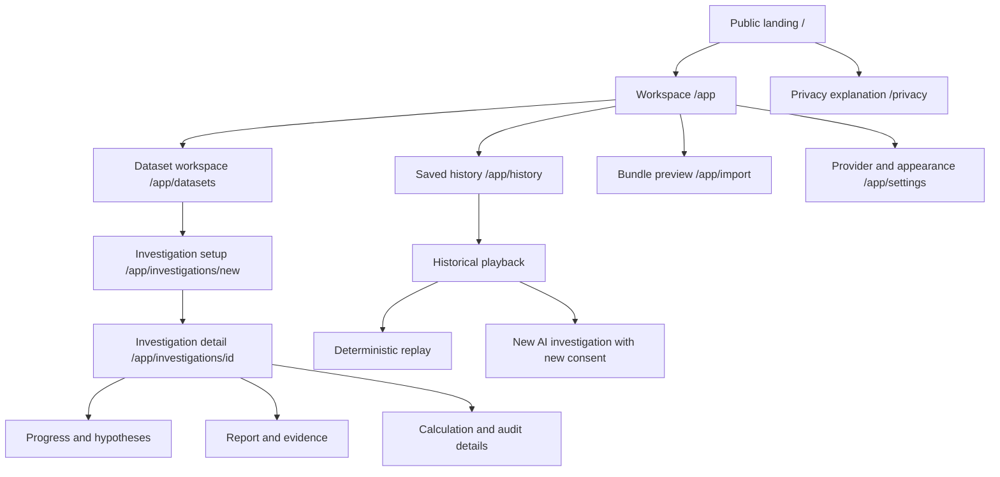
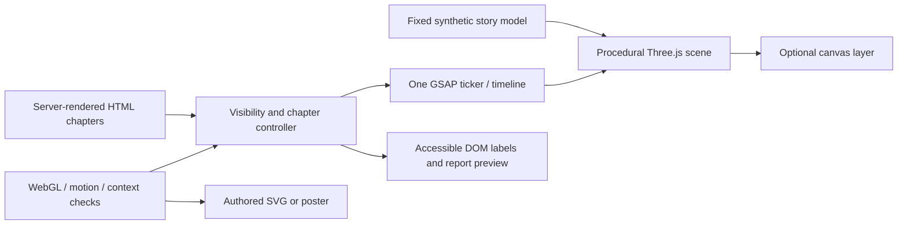

# Hypothron AI — Frontend Experience Master Plan

**Current decision: F1 rejected; design reset authorized on 13 October 2026.** Cleanup and documentation only. Stop before implementing a new landing page; that requires the user's explicit authorization. Analytical phase status and the blocked public-release gate are unchanged.

## Authoritative design-reset decision

The user rejected the previous F1 visuals. The process spread attention across six simultaneous compositions, too many references, skills and restrictions before establishing a compelling visual direction. Historical static QA and critic acceptance do not override that rejection. The Evidence Observatory concept, mineral-teal/font/token proposal and old F0–F7 ordering are superseded rather than approved inputs to a new implementation.

**Removed:** isolated F1 `prototype.html`, `prototype.css`, `prototype.js`, `tokens.css`, `validate.mjs`, synthetic fixture, five font/license/manifest assets and six screenshots. F1 was untracked and never integrated into the application; no application route/component, shared style or package required removal. See the [exact inventory and reset validation](F1_RESET_REPORT.md).

**Preserved:** the original working Next.js frontend, all API/backend/database code, browser executor, contracts, tests, locks, existing .planning artifacts, master plan and historical reports. Retained [F1 design](f1/DESIGN.md), [scope](f1/SCOPE_AND_PLAN.md), [report](f1/REPORT.md) and [review](f1/REVIEW.md) are explicitly rejected/superseded; [historical validation](f1/VALIDATION.json) remains evidence of the old static artifact only. Unrelated `next-env.d.ts` and `.env.example` changes are excluded from this task.

### Reference hierarchy and creative scope

1. **Primary:** [MeetStream](https://meetstream.ai/), for cinematic presentation, sophisticated composition, scroll-driven storytelling, depth, transitions and overall craft. Author original Hypothron imagery, scenes, copy and branding; do not copy its assets or identity. Public page content was rechecked for this reset; no fresh motion/performance audit is claimed.
2. **Secondary, only for a specific need:** [21st.dev](https://21st.dev/) for individual components and [ThreeUI](https://threeui.com/browse) for meaningful 3D inspiration. Check item source/license before future reuse; neither sets the brand nor triggers automatic dependency installation.
3. No additional reference catalogue or simultaneous dashboard directions. Use at most one relevant design skill if it materially helps a later task; **do not use awwwards or emil-design-eng**. No design skill is used for this reset.

### Frontend and motion strategy

- Keep **Next.js 15 + React 19**. **Tailwind CSS v4 is the primary styling system for the future redesign**, with custom CSS for specialized effects and semantic CSS variables where useful. This overrides the archived plain-CSS-only recommendation. Tailwind/PostCSS is not installed in the inspected repository; no existing Tailwind configuration was removed and no dependency is added during cleanup.
- Use **GSAP + ScrollTrigger** for cinematic marketing scroll choreography and **Three.js** for scenes that convey meaning. Native scrolling, lazy-loaded marketing chunks, bounded render work, disposal on navigation and reduced-motion/no-WebGL fallbacks remain required. These libraries are planned, not installed by this reset.
- Separate the marketing experience and analytical workspace in routing and bundles during a later scoped integration. Marketing must not import private dataset/session stores, executor bridge, persistence or provider clients; analytical routes must not load the marketing scene. The existing working `/` route stays accessible throughout this reset. Any future move must preserve session ownership, unsaved memory and cancellation, with tested navigation behavior.
- New colors, type and composition remain undecided until the first landing direction is reviewed. Rejected prototype tokens do not establish the new UI brand.

### Revised implementation sequence

| Milestone | Scope and exit |
|---|---|
| Reset — this task | Remove rejected static artifacts, mark history, validate original frontend, commit locally and stop |
| First new design milestone — awaits explicit authorization | One exceptional landing-page hero and a coherent scroll-driven storytelling experience; original assets/branding, composed static and reduced-motion versions, focused desktop/mobile review |
| Visual direction approval | User approves that landing direction before expanding screens or redesigning the analytical workspace |
| Separate workspace redesign | Scoped design/plan and incremental behavior-preserving implementation for dataset/metric, investigation/report, history/replay; test state ownership, consent and recovery |
| Integration and hardening | Route/bundle separation, focused browser/unit/type/build checks, accessibility and performance evidence; public release remains a separately authorized gate |

The marketing milestone comes first. Do not revive six simultaneous workspace prototypes or make a complete workspace redesign a prerequisite for the landing direction.

### Engineering constraints retained

- Preserve hypothesis-driven investigation, deterministic numerical verification and reproducible zero-inference replay. FastAPI/LangGraph owns orchestration; the frontend must not create another scheduler.
- Raw CSV/Parquet stays in browser memory by default; no raw upload, automatic snapshot persistence or new telemetry. Save/Import consent, source/metric approval, ephemeral keys and fixed provider destinations remain explicit. Metadata and aggregates are sensitive.
- Keep executor origin/CSP, trusted operation compiler/templates, bounded execution and existing contract/artifact/runtime versions. Do not relax execution policy for fonts, animation or 3D.
- Present validated claims, exact values and citations. Keep verification separate from CLIENT_REPORTED provenance; agreement is not trusted server attestation, confidence or causality. Synthetic demonstrations must be labeled; no invented capability or benchmark.
- Preserve API authorization, frozen run inputs, SSE cursor/recovery, idempotence, late-result rejection, cancellation and history/bundle/replay behavior. New application behavior requires meaningful Red → Green → Refactor tests.
- Maintain semantic HTML, visible focus, keyboard navigation, readable contrast, responsive composition, zoom/reflow and equivalent static/reduced-motion reading. Canvas cannot carry essential inaccessible content. Measure rendering/loading; do not invent scores or field-performance guarantees.
- Existing security/privacy/analytical contracts remain normative. No backend, database or trust-boundary changes are approved by rejecting a visual design. No push, deployment, paid services or public-readiness claim follows.

## Historical proposal archive — superseded visual direction

**Everything below is the preserved 13 October research proposal, not the current implementation order or visual instruction.** Its old reference breadth, skill use, styling recommendations, palette, fonts, concepts, screen designs and roadmap are historical. Useful engineering details remain context subject to the retained constraints above and current project contracts. Historical task/validation claims are not fresh reset results.

**Research date:** 13 October 2026

**Status:** Proposed direction; awaiting design review. This document does not authorize implementation or advance the project phase.

**Scope:** Repository audit, reference research, original art direction, experience specifications, and an engineering roadmap. No application, backend, database, runtime, or dependency changes are part of this task.

## 1. Recommendation and design brief

Build **The Evidence Observatory**: a dark, spatial public experience that turns a branching investigation into a readable, cited report, paired with a calm, highly legible workspace in light and dark themes. The recognizable visual device is **two calculation paths meeting at an evidence reference**. It represents the product's real SQL/Pandas numerical comparison without implying independent server attestation.

The signature landing-page moment is a constellation resolving into a report. Data-source planes become proposed hypotheses; approved operations move through two calculation lanes; results are compared; citations settle into an ordinary HTML report. Agreement, disagreement, and insufficient evidence have distinct endings. The report remains the destination, rather than the animation becoming the product.

Use **GSAP with ScrollTrigger and a lazy-loaded Three.js scene on marketing pages**, with **CSS transitions, Intersection Observer, and SVG in the workspace**. Keep native scrolling. Motion for React, React Three Fiber, and Drei are evaluated alternatives, not simultaneous default dependencies. Start with the static design and SVG storyboard before approving WebGL complexity.

| Brief field | Proposed decision |
|---|---|
| Audience | Analysts, product/operations teams, and technical evaluators who need defensible answers from local tabular data |
| Primary public action | Open the local investigation workspace; a clearly labeled synthetic demonstration is secondary |
| Primary application action | Configure an exact metric, calculate locally, then optionally authorize an AI investigation |
| Emotional direction | Deliberate, precise, curious; confidence in the process rather than exaggerated certainty in an answer |
| Concept-specific visual language | Source planes, hypothesis branches, paired calculation tracks, evidence references, a composed report |
| Composition | Asymmetric editorial hero; one spatial story; restrained interface demonstrations; generous quiet sections |
| Color | Ink blue-green, mineral teal, warm neutral paper; semantic amber/red used only for actual states |
| Typography | Manrope for display and interface; IBM Plex Mono selectively for code and technical identifiers |
| Motion character | Purposeful convergence and continuity; short, interruptible application feedback |
| Asset strategy | Original procedural geometry, self-hosted fonts, authored SVG, real interface captures using synthetic fixtures |
| Explicit exclusions | Fake confidence, unsupported charts, invented customers, scrolling hijacks, decorative dashboard WebGL, glassmorphism, purple-gradient branding |

This applies the [awwwards skill](/Users/yuvrajsatyapal/.agents/skills/awwwards/SKILL.md) concept/art-direction/quality principles and Emil Kowalski's design-engineering principles. The skill path above is local to the research environment and is not a portable repository dependency; the source package is [emilkowalski/skill](https://github.com/emilkowalski/skill). A review should assess specificity, hierarchy, usability, and motion purpose rather than assign an unearned award score to an unbuilt design.

## 2. Research method, evidence, and boundaries

### 2.1 What was inspected

The audit read root/workspace manifests and the lockfile; the Next.js routes, styles, components, client libraries, executor host/workers; backend report and orchestration contracts; project specifications, ADRs, security/replay protocols; and existing test/evaluation reports. Current UI judgments below are **source-based**. No fresh application browser walkthrough, application regression suite, or performance benchmark was run for this documentation task.

Reference research combined live browser inspection where it worked with public page/catalog extraction and official license/documentation sources. MeetStream and 21st.dev were actually viewed. A subsequent browser batch timed out, including attempts involving One Page Love and Awwwards; a recovery attempt also timed out. Remaining findings therefore identify content inspection separately from observed animation. A screenshot cannot establish a site's rendering library, frame rate, accessibility, or licensing.

Implementation statements are anchored to the research baseline `85349a9825ea1206074d6f7a2b9e8a876a98d403`, [CURRENT_PHASE.md](../../CURRENT_PHASE.md), and the source links below. [PRD.md](../../PRD.md), [ROADMAP.md](../../ROADMAP.md), and some early security text include historical or target-state descriptions. They do not override the newer phase status, accepted ADRs, or implemented contracts. For example, general analytical charts remain a target; the present report supports a restricted engine comparison.

### 2.2 Current readiness is local, not a public release claim

Phases 0–4 and 4.5 are complete for their documented scopes. Phase 5 T5.1–T5.3 passed as a **local v1 release candidate**; the public deployment/live-host exit T5.4 remains blocked. No Phase 6 has started.

The existing [Phase 5 report](../reports/PHASE_5_REPORT.md) records 118 backend tests, 113 unit tests, and 39 production Chrome integration tests, plus type/lint/migration/build checks. These are **historical repository results**, not checks rerun here. Its evaluation uses scripted policies, not proof that a live provider outperforms another. The tested desktop is Chrome on macOS/Apple M2 with 8 GiB RAM. Narrow viewport checks are not physical mobile execution certification. Actual-host headers, live-provider behavior, Safari/Firefox, and hard peak-memory guarantees remain unproven.

The visual redesign must preserve those limits in product copy. “Designed toward production quality” is a design objective; “production ready everywhere” is not an established fact.

## 3. A — Current frontend audit

### 3.1 Stack and module inventory

| Area | Verified implementation | Design implication |
|---|---|---|
| Workspace | pnpm 10.33.0; `pnpm-workspace.yaml` includes `apps/*`; API is a separate Python/uv service; contracts are not a JavaScript workspace package | Preserve the separate executor and API boundaries |
| Web framework | Next.js App Router, React 19, strict TypeScript; lockfile resolves Next 15.5.27 and React/React DOM 19.3.0 | Design against installed versions; no framework upgrade is required by this proposal |
| Routes | One substantive client page at [app/page.tsx](../../apps/web/app/page.tsx), plus layout and globals | A real marketing/workspace split is new work |
| Styling | Plain [globals.css](../../apps/web/app/globals.css), CSS custom properties, system sans and Georgia heading | There is no Tailwind configuration to audit; retain CSS variables rather than add Tailwind for reference components |
| State | React local state/refs, abort controllers, generation guards, frozen run contracts | Route restructuring must preserve in-memory ownership and cancellation |
| Persistence | Dexie; explicit consent before creating/writing investigation storage | A dashboard must not silently persist files or manufacture a cloud library |
| Charts | Custom exact-value SVG engine comparison with a supporting table | No general chart library or arbitrary time-series output exists |
| Animation/3D | No established animation or 3D dependency | Add dependencies only after the design and bundle spike pass |
| Testing | Vitest, strict TS, focused Playwright production flows; executor tests include real Pyodide checks | Existing behavioral tests are valuable regression anchors |

Root sources: [package.json](../../package.json), [workspace definition](../../pnpm-workspace.yaml), [lockfile](../../pnpm-lock.yaml), [web manifest](../../apps/web/package.json), [executor manifest](../../apps/executor/package.json), [file map](../../FILE_MAP.md).

### 3.2 What already works and must survive

**Exact local calculation.** [page.tsx](../../apps/web/app/page.tsx), [ingestion.ts](../../apps/web/lib/ingestion.ts), and [execution.ts](../../apps/web/lib/execution.ts) accept bounded CSV/Parquet, establish identity and source approval, and calculate in the isolated executor. Parquet preserves its original identity and an approved canonical CSV. Amount/date columns, date interval, currency, timezone, null policy, grain, and an optional approved lookup define the metric. SQL and fixed Python calculate exact totals/counts and diagnostics. The supported public analytical operation is `revenue_sum` IR v1/v2, not arbitrary SQL, free-form Python, or a general BI query builder.

**Typed, bounded AI investigation.** [Investigation.tsx](../../apps/web/components/Investigation.tsx) integrates the API/LangGraph flow after local calculation. It exposes the question, provider/model, ephemeral key, disclosure consent, approved hypotheses/operations, evidence, report, cancellation, pause/resume, and bounded additional source inputs. The backend owns orchestration; the frontend must not invent another agent scheduler. Existing source-count and operation limits should drive the form, not a speculative unlimited connector UI.

**Durable events and submission.** [investigation.ts](../../apps/web/lib/investigation.ts) and the investigation component use authenticated fetch-based SSE with a monotonic cursor and bounded buffering/reconnection. Result submission and graph advancement are distinct operations. Events communicate changes; authoritative state determines what happens next. Preserve deduplication, late-response rejection, abort handling, and idempotent behavior. There is no reliable denominator for a percentage-complete dial or completion ETA.

**Evidence that can be inspected.** [EvidenceReport.tsx](../../apps/web/components/EvidenceReport.tsx), [report.ts](../../apps/web/lib/report.ts), and [reporting.py](../../services/api/src/hypothron/reporting.py) validate restricted reports and exact claims. Existing signed bars distinguish positive, negative, zero, unavailable, and tiny values; the exact table is authoritative. Evidence carries dataset/contract versions, citations, execution artifacts, verification, and provenance. Arbitrary causal explanations are rejected.

**Consent-based local history and reproducible replay.** [LocalHistory.tsx](../../apps/web/components/LocalHistory.tsx), [storage.ts](../../apps/web/lib/storage.ts), [artifacts.ts](../../apps/web/lib/artifacts.ts), [bundles.ts](../../apps/web/lib/bundles.ts), and [replay.ts](../../apps/web/lib/replay.ts) already support Save, metadata listing, explicit Load, strict import preview/confirmation, bundle export, deletion, historical playback, and deterministic replay. Replay validates identity/runtime/compiler locks and executes approved plans with zero inference. Parquet replay uses saved canonical CSV after original identity validation; it does not constitute a second independent Parquet decode. Fresh AI is a separately consented, potentially billed investigation, not replay. [comparison.ts](../../apps/web/lib/comparison.ts) compares actual saved/fresh artifacts without claiming identical reasoning.

### 3.3 Before / After / Why

| Before — verified current interface | After — proposed experience | Why |
|---|---|---|
| One long client page combines contract fields, executor output, AI setup, reports, and history | Workspace shell with task-focused views and progressive disclosure | Users can complete one decision at a time without losing inspectability |
| “Deterministic browser foundation” and implementation-oriented labels dominate | “Investigate your data” with plain-language privacy and calculation explanations | Communicates the job and value before implementation mechanisms |
| Dense amount/date/advanced controls precede context | Dataset selection → metric definition → local calculation → optional AI setup | Matches the actual prerequisite flow and prevents premature AI promises |
| CSV-oriented wording appears alongside working Parquet input | Format-aware labels and precise supported-type/size errors | Removes a real inconsistency without expanding format support |
| Text inputs for column names; no general dataset preview | Searchable column selection and a bounded, browser-only preview, if its spike passes | Reduces mapping mistakes; this is genuinely new functionality |
| Provider credentials and technical execution details share the main workflow | Dedicated consent review and expandable calculation/audit panels | Maintains explicit decisions while reducing visual overload |
| Pending hypothesis text and event names appear in utility panels | Semantic run stages and a compact activity ledger with timestamps where available | Makes work understandable without showing fabricated chain-of-thought |
| Report presentation is visually modest but numerically careful | Editorial report with cited finding cards and exact comparison figures | Improves hierarchy while preserving the report validator's limits |
| Save/history/replay/import controls cluster within the page | Separate memory-only session, saved history, and import/replay flows | Makes persistence consent and zero-inference replay distinctions obvious |
| Light-only paper/rust palette; sparse component system | Original mineral-teal brand; readable light/dark surfaces and consistent states | Gives the product identity without borrowing a component-library skin |

### 3.4 Preserve, redesign, and genuinely missing

| Classification | Items |
|---|---|
| Preserve behavior | Source approval; exact arithmetic; original/canonical lineage; typed plans; fixed operation limits; paired engines; API authorization; key lifetime; consent; executor origin; SSE recovery; frozen run snapshots; strict report validation; artifact/replay compatibility |
| Redesign presentation | Navigation, hierarchy, form grouping, report typography, activity explanations, diagnostics disclosure, history cards, import review, empty/error/loading states, responsive layouts |
| Missing frontend capabilities | Marketing route, app shell, dark theme, coherent tokens, general local row preview, column mapping selector, polished stage timeline, accessible hypothesis/evidence overview, dedicated report/history/settings experiences |
| Not currently available | General time-series/grouped charts, confidence scores, causal findings, forecasting, unlimited analytics, cloud sync, accounts/team collaboration, remote connectors, trusted server execution attestation |

Do not disguise the last row with mock dashboard charts, empty settings switches, or marketing claims. A browser-only preview might require a scoped ingestion/protocol extension; if the spike cannot reuse approved local parsing safely, write a separate specification instead of silently expanding the executor.

### 3.5 Existing security and UX constraints

Raw inputs remain in browser memory until explicit Save. Existing saved metadata may be listed without creating a new database; opening a dashboard must not create/write investigation storage. Saved files are unencrypted at the app origin and browser storage may be evicted. Restoring data, saving it, and exporting it must remain visible user actions.

Questions, column names, hashes, metric definitions, and bounded approved aggregate evidence can be sensitive even when raw rows stay local. AI consent must name what leaves the browser. Keys remain short-lived in browser/API memory, absent from URLs, graph state, storage, exports, prompts, and traces. The executor receives data for approved local calculation, not provider credentials.

The current [executor server](../../apps/executor/server.mjs) establishes a separate credential-free origin with restrictive host/worker policies and narrowly scoped WASM allowances. The [Next configuration](../../apps/web/next.config.mjs) does **not** itself configure an application-wide production CSP or COOP/COEP. Separate-origin workers are not proof that `crossOriginIsolated` is enabled or that hostile client results are attested. The redesign must not relax executor policy to make fonts, 3D, or remote assets convenient. Review actual-host policy under [SECURITY.md](../../SECURITY.md), [DECISIONS.md](../../DECISIONS.md), and [DEPLOYMENT.md](../DEPLOYMENT.md).

## 4. B — Reference research

### 4.1 Comparative findings

| Reference and inspection level | Relevant patterns | Impressive but unsuitable | Recreate and adapt originally |
|---|---|---|---|
| [MeetStream](https://meetstream.ai/) — live mobile and desktop hero, sampled scroll sections, full page text | Spatial hero; lower-left headline/CTA; mobile navigation; connected artifact cards; dark-to-content transitions; broad editorial section rhythm | Metallic spectacle everywhere, warm orange identity, meeting-specific objects, any assumed heavy scroll machinery | A mineral-teal evidence scene, paired calculation tracks, real report previews; native sticky layout plus scroll state. Its exact animation stack was not established |
| [21st.dev](https://21st.dev/) — live desktop and public catalog | Component discovery, compact category navigation, preview surfaces; catalog examples include Agent Plan and Background Beams; [Motion Primitives listing](https://21st.dev/@ibelick/library/motion-primitives) suggests useful disclosure/transition patterns | Gradient-heavy hero imitation; background beams in analytical views; installing Tailwind/shadcn solely for copied snippets | Rebuild small disclosure, navigation, and feedback patterns in existing React/CSS; investigate each component's upstream license before reuse |
| [One Page Love](https://onepagelove.com/) and [sections](https://onepagelove.com/sections) — content/catalog only; live browser failed | Section-level research and coherent one-page pacing; compare hero, demonstration, explanation, and closing roles | Treating a collection of attractive sections as a coherent product; adopting templates unchanged | Use a storyboard with distinct layout families and a continuous evidence narrative. Specific animations and current site examples were not visually verified |
| [Awwwards](https://www.awwwards.com/) — homepage/category fetch failed; official indexed editorial/collection excerpts available | Strong art direction and navigational storytelling; [official navigation editorial](https://www.awwwards.com/30-examples-of-innovative-navigation-experiences.html) provides historical examples | Award-chasing transitions that obstruct reading, kinetic navigation, scroll hijacking | Use originality/usability as review criteria and one signature transformation. No current winner was live-inspected; older editorial is not evidence of today's implementation practices |
| [Obsidian UI components](https://www.obsidianui.dev/components) — public catalog/docs only | [Dashboard Shell](https://www.obsidianui.dev/docs/dashboard-shell), grouped navigation, dense surfaces, state treatments; Status Bars communicates categorical status | AnalyticsDashboard's PR-related demo metrics; service-uptime bars presented as investigation progress; Draggable Marquee/Text Reel/Flip Text in routine work | Author a Hypothron shell and state vocabulary using real contracts. Keep report content static/readable and technical detail collapsible |
| [ThreeUI browse](https://threeui.com/browse) — catalog and item descriptions; no live rendered scene | [Constellation Field](https://threeui.com/backgrounds/constellation-field/constellation-field) describes node/link variation; [Dot Matrix](https://threeui.com/three-js/structure-flow/dot-matrix) describes spatial point structures | Dense particle vortices, generic ambient backdrops, incompatible old snippet runtimes, paid components assumed free | Independently model a small semantic graph. Constellation listing describes Canvas 2D/raw WebGL; Dot Matrix describes Three.js variants. These are descriptions, not observed animation behavior |
| [Collect UI](https://collectui.com/) — extracted current public content only | Broad visual curation and newsletter discovery can inform later composition reviews | Assuming the historical Daily UI collection is fully available; copying unattributed shots | Current content showed newsletter/directory material and incomplete/loading design entries. No concrete upload/dashboard interaction was verified; do not claim a tested component reference |

MeetStream's sampled desktop scroll showed white transcript/participant/video cards connected against a dark field, followed by wide heading/copy compositions and an isometric integration object. The transferable idea is **progressive explanation through related artifacts**. Those artifact types, imagery, layout proportions, and motion timings should not be duplicated. The source library, pinned behavior, frame rate, and reduced-motion handling were not audited.

21st.dev was viewed as a discovery/catalog interface, including author credits and horizontal component previews. Obsidian/ThreeUI previews were not run; public descriptions are sufficient to identify candidate patterns, not sufficient to endorse their performance or accessibility. All references are inspiration, not proof that adopting their implementation is compatible with Hypothron.

### 4.2 Free, paid, and licensing distinctions

| Source | Verified status | Decision |
|---|---|---|
| MeetStream | Published site design/assets are not offered here under a reusable open-source license | Study composition; create our own copy, geometry, imagery, and interface |
| 21st.dev | Public catalog describes limited free copying and paid membership/premium access; component licenses depend on authors/upstream sources | Free browsing does not imply every snippet is MIT or redistributable; no bulk install |
| One Page Love / Awwwards / Collect UI | Curation sites, not a blanket component license; individual templates/assets may have separate free/paid terms | Inspiration only unless a specific upstream license is verified |
| Obsidian UI | [Repository license](https://github.com/Atharvsinh-codez/ObsidianUI/blob/main/LICENSE) is MIT; [developer guidance](https://www.obsidianui.dev/developers) distinguishes third-party assets | Attribution/license preservation if code is later used; replace media with owned assets |
| ThreeUI | [Community repository](https://github.com/MengTo/threeui) and [MIT license](https://github.com/MengTo/threeui/blob/main/LICENSE); Pro/Beta material has different access/terms | A catalog item's presence does not establish Community eligibility. Named examples' free entitlement was not verified; build original procedural scenes |

Before any future component import, record exact repository/file/version, license, attribution, asset licenses, accessibility findings, CSP requirements, and bundle cost. Reject network-loading templates and snippets that transmit analytics/data by default. Nothing was pasted into the application during this task.

## 5. C — Three original visual directions

### 5.1 Direction A: Evidence Observatory / Evidence Constellation

**Visual identity:** Midnight blue-green, matte luminous lines, clear typography, a few source planes and evidence nodes. The scene resembles a structured investigation map rather than an astronomical universe. Hypotheses are branching proposals, not confidence-weighted stars. Two engine tracks are visibly separate; citations become stable report anchors.

**Strength:** Explains the product's differentiators through one continuous object. It works in an interactive landing story and in a simpler SVG application diagram. The layout can reserve quiet space for substantial text.

**Weakness:** An uncontrolled graph becomes visual noise. Edge direction could imply causality, and green convergence could imply trusted attestation. Cap topology, label relationships as operations/evidence, and offer non-agreement outcomes.

### 5.2 Direction B: The Proof Sheet / Data-to-Insight Transformation

**Visual identity:** Warm paper, dark editorial type, precise teal annotations. A shallow 3D field of record tiles becomes a column definition, then a calculation sheet, then a cited report. Large empty margins and aligned figures evoke a reviewed document.

**Strength:** The clearest explanation for non-technical users, naturally responsive, excellent static fallback, and strong report continuity. It needs fewer moving objects and almost no lighting complexity.

**Weakness:** Less distinctive spatially and risks looking like a polished spreadsheet landing page. A collapsing point cloud must not imply that actual uploaded records enter marketing code. Use synthetic data and fixed mappings only.

### 5.3 Direction C: The Investigation Engine

**Visual identity:** Graphite cutaway layers, restrained teal rails, numbered plates for planning, computation, comparison, and reporting. An orthographic camera exposes a modular engine as sections separate and reassemble.

**Strength:** Strong technical portfolio image; operation boundaries are tangible, and modular geometry is maintainable without purchased models.

**Weakness:** Can resemble generic infrastructure hardware and imply server processing. Transparent layers, moving lights, and repeated camera travel increase cost while explaining less. Clearly label the browser/API boundary or reject it as the primary public metaphor.

### 5.4 Evaluation and recommendation

These are planning judgments, not measured user research or benchmark results.

| Criterion | A — Observatory | B — Proof Sheet | C — Engine |
|---|---|---|---|
| Visual impact | High; recognizable paired-path signature | Moderate/high; typography carries it | High; strong cutaway object |
| Product relevance | Very high if evidence/provenance is explicit | Very high for the basic calculation story | Medium; risks obscuring local processing |
| Implementation complexity | Medium; bounded semantic graph and scroll states | Low/medium; arranged tiles and DOM continuity | High; layered choreography and lighting |
| Performance cost | Low/medium with caps and no postprocessing | Lowest; CSS/SVG can carry most scenes | Highest of the three |
| Mobile suitability | Good with orthographic snapshots and fewer nodes | Excellent | Fair; layer labels compete for width |
| Accessibility | Good through equivalent DOM chapters and static SVG | Excellent through document-first presentation | Requires the most explanatory fallback |
| Maintainability | Good with explicit topology and one animation clock | Best; few scene states | Medium; more coupled visual mechanisms |
| Paid assets needed | No; procedural geometry | No; authored tiles/SVG | No; procedural plates |

**Recommend A**, borrowing B's simple record-to-column opening and document-like report ending. This is one bounded constellation scene, not multiple independent 3D worlds. Direction C is useful as a static architecture illustration in a technical case study, not the default hero.

## 6. D — Information architecture and page specifications

### 6.1 Proposed route and state model

The following routes are proposed, not present today. A route migration must first pass memory-lifecycle tests. Keep a stable client session owner at the workspace layout so navigation does not reload private data, recreate executors, or abandon cancellation. Per-run tabs can be local views initially; do not multiply routes before state ownership is proven.



Identifiers in routes are opaque investigation IDs, never keys, authorization tokens, dataset names, or hashes. A URL does not grant access or restore unsaved bytes. On reload without a usable session, explain that memory-only data is gone and offer explicit Load/import/select again. No automatic cloud recovery is implied.

### 6.2 Public landing `/`

**Purpose:** Explain local data investigation and distinguish verified numbers from unsupported AI narration. Primary CTA: “Open workspace.” Secondary: “See the investigation,” scrolling to a clearly labeled synthetic demonstration. A small current-availability label should say local/demo where appropriate; do not imply a hosted service is released.

Navigation: Product/story anchor, How it works anchor, Privacy page, Open workspace. Desktop text navigation; mobile menu with Escape, focus containment/return, and no full-screen kinetic lettering. Header remains readable over the hero. Avoid app-route prefetch that initializes executor/runtime assets before explicit entry.

The hero and every chapter contain actual HTML headings/copy. 3D supplements them. Interactive example controls change synthetic outcomes between agreement, disagreement, and insufficient evidence; they do not connect to real files or providers. A paused-motion control is visible when continuous movement is enabled.

### 6.3 Workspace home `/app`

**Purpose:** Resume the current memory-only session or explicitly open a saved investigation. Top action: “Start investigation.” Below it: current session, then saved metadata if an already-consented database exists. Distinguish “In this session” from “Saved on this browser.” No fabricated KPI tiles, team activity, or cloud synchronization.

Empty state explains three steps: select a local dataset, define the metric, inspect calculations. Secondary actions: use the known synthetic example or preview an investigation bundle. If storage is unavailable/evicted, explain recovery options without repeatedly recreating it. On mobile, use stacked summaries and a simple navigation menu; cards have a single clear primary link.

### 6.4 Dataset workspace `/app/datasets`

**Purpose:** Understand and approve local source identity before execution. Show filename only inside the app, format, byte size, source role, and supported-type validation. File selection should say “Select local file” rather than suggest server upload. Keep drag/drop optional alongside a keyboard-operable file button.

Proposed bounded preview: first 20 rows, at most 12 visible columns per page, truncated cells with explicit expansion, and no claim that the preview is a statistical sample. Parse/inspect in approved browser code; release preview buffers when replaced. Never send rows to the API or include them in logs. Unsupported Parquet types must yield the existing precise reason, not a lossy coercion. Failure to implement this safely must not delay the basic form redesign.

Column mapping selects amount/date columns from validated local schema if available. Metric definition displays interval boundaries, currency, null behavior, grain, and fixed-offset timezone in human language. Advanced disclosure contains exact technical names and optional lookup configuration. Do not offer unsupported IANA/DST handling, currency conversion, or many-to-many joins.

Approval includes original/canonical lineage when relevant. For independent additional sources, show their role and constraints instead of reusing lookup language. Existing limits remain enforced: bounded files, limited source identities, and supported exact scalar types. The full resource contract is authoritative over UI convenience.

States: selecting, validating, awaiting source approval, ready to calculate, calculating, cancelled, and rejected. A real stage label is better than an invented percentage. Mobile uses a local horizontal table scroller with clear headers; the page itself must not overflow.

### 6.5 Investigation setup `/app/investigations/new`

**Purpose:** Ask a supported question against a frozen metric/source configuration. Present stages: Data → Metric → Local calculation → Question and provider → Review. Users can inspect local calculation without invoking AI. Preserve the current local-calculation prerequisite rather than promising arbitrary questions before a valid contract exists.

Question examples must be taken from supported evaluation scenarios. Explain that the current investigation proposes bounded operations around exact totals/counts and compatible comparisons. Do not show forecasts or causal prompts that the engine cannot deliver.

Provider selection exposes the existing Gemini/OpenRouter choices and model configuration. Keys use a password field held in ephemeral memory with a clear remove action. A model identifier is configuration, not proof of current provider availability. Keep original provider/model/question fixed for an active run; edits apply to a new run.

The final review names the information sent: question, column metadata, hashes, metric definitions, and bounded approved aggregate evidence; raw rows remain local under the present model. Explain backend metadata retention and opportunistic cleanup using the actual policy, without claiming deletion occurs at an exact second. Consent is unchecked, specific, and adjacent to “Start AI investigation.” No consent hidden in general terms, no retained key on Load/fresh investigation.

Errors identify unsupported configuration, executor readiness, invalid/expired credentials, unavailable provider, and policy rejection separately. Keep user's safe form choices while clearing credentials according to existing lifecycle rules.

### 6.6 Investigation progress and hypotheses

**Purpose:** Explain what is happening and make cancel/pause/recovery understandable. Show semantic stages: preparing, proposing a hypothesis, approving an operation, calculating locally, comparing results, assembling a report, complete/inconclusive/failed. Map these to authoritative graph state; only show a stage when the state supports it.

Use an ordered activity list with actual event names translated to plain language, timestamps only where the contract supplies them, and a reconnecting indicator. Do not display private model reasoning, fake agent conversations, confidence animations, or a continuous “working” stream when paused.

Hypothesis cards show available ID, proposed question/rationale, status, and evidence dependencies from typed artifacts. A simple SVG relationship view is supplementary; the accessible list is primary. Node position encodes workflow relationship, not statistical strength. Avoid showing speculative nodes as confirmed findings.

Cancel is always reachable and bounded by existing worker/bridge behavior. Reconnection must preserve the ledger cursor and never duplicate local jobs. If work awaits approval or a lost key, surface that decision rather than hiding it behind a spinner. Use polite, throttled announcements on stage transitions; do not announce every SSE event.

### 6.7 Investigation report and findings

**Purpose:** Answer what the engine can actually support. Layout: title/context, overall outcome, a short constrained summary, exact metrics, cited findings, calculation comparison, data-quality diagnostics, limitations, then actions. A right-side contents rail can become a mobile section menu. Report reading width is narrower than operational tables.

The summary is a **deterministic presentation of validated conclusions and claims**, not a new browser LLM call or an unvalidated narrative. If the backend provides only its deterministic fallback, identify that fallback and show its available observations. A count of findings is a local count of report entries, labeled as such; it is not a business KPI.

Each finding links to its actual evidence and displays supported/disputed/inconclusive assessment separately from numerical verification and origin. Place “Calculations agree locally” alongside “Reported by this browser; not independently attested” when appropriate. Do not bury the provenance qualification only inside a tooltip.

Evidence links open a focused panel, retain report position, and are keyboard-operable. Save, export, and replay have distinct actions and explanations. “New AI investigation” states that it uses a provider and requires fresh consent. Historical playback never silently starts new work.

### 6.8 Evidence and independent calculation verification

**Purpose:** Inspect the two calculations and their provenance. Show SQL result, Python result, exact agreement/difference status, count, schema, diagnostic differences, and dataset/metric versions. Keep an exact-value table next to the signed comparison visual. Do not count up monetary values or convert BigInt through floating-point display helpers.

Explain three separate axes:

| Axis | Plain-language label | Meaning |
|---|---|---|
| Numerical verification | Calculations agree / disagree / cannot be compared | What the two approved calculation results establish |
| Finding assessment | Supported / disputed / inconclusive | Whether the report's allowed observation is supported by cited evidence |
| Provenance | Reported by this browser | Source of the supplied result; not trusted server attestation |

The engines independently calculate approved arithmetic locally. They share parts of the input/runtime pipeline, including canonical Parquet decoding. Show that limitation in the calculation explanation. Hashes establish identity/integrity relationships, not truth of execution. Never use “independently attested,” “server verified,” or a certification seal for `VERIFIED + CLIENT_REPORTED`.

### 6.9 Technical provenance and audit

**Purpose:** Give technical users the original artifacts without making everyone read them. Sections: source identity and lineage; metric contract/version; approved plan; inspectable generated SQL/fixed Python; runtime/compiler locks; graph/events; report validation/fallback reason; replay comparisons. Copy actions are explicit and contain no keys.

Retain exact error/rejection codes alongside explanations. Expanding a panel should not fetch raw rows from a server. Render untrusted strings as text; code viewers must not execute them or expose new HTML/script injection. Audit records are sensitive exports, not decorative public share cards.

### 6.10 Saved investigations and historical playback `/app/history`

**Purpose:** Browse consented local metadata, then deliberately restore an artifact. List title/date/source format/state and original/replay/fresh relationship only when stored. Sorting/filtering operates on available metadata, not fabricated indexed raw data. “Load” explains that it restores files into memory.

Save requires the existing explicit consent and communicates browser-local, unencrypted, evictable storage. Show real storage errors and offer export; do not invent an exact remaining-quota guarantee from approximate browser estimates. Delete confirmation identifies the record and relevant local artifact behavior; preserve existing atomic/orphan cleanup.

Historical view prominently says “Saved report.” It offers playback, deterministic replay, export, and fresh AI as different modes. A saved lookup or multiple-source artifact restores its actual source structure. Local history is not a general dataset catalog.

### 6.11 Import/export and deterministic replay

Import starts with in-memory validation. Preview manifest version, sources, runtime requirements, findings availability, and any failure code before the unchecked confirmation that permits persistence. Invalid bundles never get partial storage. Do not imply arbitrary ZIP contents are safe; preserve strict manifest/size/hash validation.

Export describes inclusion of raw local datasets and sensitive metadata so the user understands what the file contains. No external sharing service or automatic download is proposed.

Replay shows Validate artifact → Check runtime → Recalculate approved plans → Compare results. “No AI requests” refers to inference; an uncached runtime may still require permitted asset loading. A locked-runtime mismatch is an explicit failure, not an invitation to silently use the current runtime or fresh AI. Original reports remain immutable; append replay records and distinguish MATCH from a new attestation.

Fresh AI clears keys/consent, restores supported source configuration, creates a new parent-linked run, and reports available structural/token/timing differences. Similar text/IDs do not establish identical reasoning.

### 6.12 Provider and appearance settings `/app/settings`

Group ephemeral provider configuration, disclosure explanation, and appearance. No fake organization/account/billing settings. Theme follows system by default with explicit light/dark choice in memory; if persistent appearance preferences are later desired, scope that separately from investigation storage. Never use theme initialization to open Dexie.

### 6.13 Privacy explanation `/privacy`

A concise factual diagram separates browser memory, local Save storage, executor origin, API metadata/approved aggregates, and external provider. Explain what is transmitted and when; key lifetime; browser-local retention; replay versus fresh AI; and the limits of client-reported verification. Avoid blanket “nothing leaves your device,” “fully offline,” or “zero knowledge” claims.

## 7. E — Landing-page scroll storyboard

Native scrolling controls narrative progression. Only one desktop story region may use a bounded sticky/pinned scene. There is no mandatory wheel interception, hidden overflow on the page, or trapped scroll. Mobile/reduced-motion versions tell the same story with ordinary sections and static SVG states.

| Section | Composition and content | Motion and scroll behavior | What the visitor learns |
|---|---|---|---|
| 1. Opening: “Follow the evidence.” | Asymmetric hero: headline/copy/CTAs occupy about five columns; the constellation occupies the remainder. A synthetic source plane and two faint calculation lanes establish the visual vocabulary | Static poster is immediate; scene loads after the text. A short entrance settles, then stops. No perpetual camera orbit | Hypothron turns local data questions into inspectable investigations |
| 2. The privacy boundary | Wide quiet band: browser boundary diagram and precise “Local rows. Explicit sharing.” explanation. Opened details name metadata/aggregates sent for AI | SVG lines reveal once as the section enters; static under reduced motion | Local computation and provider consent are different decisions |
| 3. One investigation, six chapters | Text rail beside a single spatial story. Desktop sticky container spans at most roughly four viewport heights, with readable chapter stops; no second overlapping pin | Scroll selects/interpolates explicit chapter states. Text remains ordinary DOM. Backward scrolling reverses safely; chapter links allow direct navigation | The process is data → question → hypothesis → calculation → comparison → report |
| 3a. Data | Synthetic record tiles align into a source plane; fixture label always visible | Small translation/reorganization, no exploding particles | The data remains a defined local source |
| 3b. Question | A visible plain-language question anchors the source | Question frame appears; camera changes gently | Investigation begins with a specific, bounded question |
| 3c. Hypotheses | A few labeled branches form, marked proposed | Branch paths draw; no probability weights | AI proposes explanations/operations; proposals are not findings |
| 3d. Calculation | Approved operation travels through two distinct lanes | A restrained path pulse moves once per lane; HTML labels name SQL and Python | Exact calculation is separate from model reasoning |
| 3e. Comparison — signature moment | Two result markers align against an evidence reference. Controls choose agreement/disagreement/insufficient evidence | Values do not count up. Geometry converges only on agreement; divergence and incomplete paths have coherent alternatives | Numerical agreement is testable, and disagreement is useful information |
| 3f. Report | Spatial marks flatten toward a real HTML report card with citations | Scene fades as the DOM card takes precedence; canvas never contains essential report text | The output is a readable report linked to inspectable evidence |
| 4. Inspect the answer | Broad product preview with summary, finding, evidence panel; caption “Synthetic example” | Accessible tabs switch Overview / Evidence / Calculation. Short CSS fades; no automatic carousel | Readers can move from a claim to its actual calculations |
| 5. Reproduce the investigation | Three editorial columns/steps: saved artifact, approved plan/runtime lock, result comparison | Lightweight SVG path progression once; no network/inference theater | Replay recalculates approved work without new AI requests |
| 6. Engineering and limits | A text-led section showing real architectural differentiators and links to a case study; local candidate status and attestation caveat visible | Static. Optional small expanders for what is currently supported | Trust comes from explicit boundaries and reproducibility, not unsupported badges |
| 7. Questions before you begin | Accessible disclosure list: formats, local Save, provider sharing, replay, current availability | Native/controlled disclosure with minimal expansion feedback | Important consent and capability questions have clear answers |
| 8. Closing: “An answer you can inspect.” | Quiet full-width composition; the final evidence reference becomes a restrained brand mark. Open workspace CTA and privacy link | One subtle reveal, then stillness | The product promise resolves in useful, inspectable work |

Use [orders.csv](../../tests/fixtures/orders.csv) as an initial demonstrator only after validating its configured interval/null policy: the July–September interval with excluded nulls gives 3 included records totaling USD 30.33, while the October record lies outside the interval. Label all values synthetic and show the actual interval. Alternative outcomes must be visibly illustrative simulations, not fabricated production evidence or public controls that alter real verification.

Hero/canvas art direction: orthographic or very restrained perspective, generous negative space around text, matte source plates, teal operation paths, and a small warm-white evidence point. Avoid starfield noise, reflective chrome, faux holographic monitors, and labels embedded in 3D textures. The source plane and report frame share an original corner/notch detail that can become the brand mark.

## 8. F — 3D and motion technical proposal

### 8.1 Smallest coherent stack

| Technique | Proposed use | Why / license |
|---|---|---|
| CSS transforms/transitions | Application press/hover/focus, popovers, tabs, brief state changes | Existing stack; short, interruptible feedback; no animation package required |
| Intersection Observer | Start/stop optional marketing work; simple one-time reveals | Native API, no continuous scroll React state |
| SVG | Accessible diagrams, exact comparison charts, static/no-WebGL story | Small, inspectable, responsive; text/table equivalents remain |
| GSAP + ScrollTrigger | One marketing timeline, chapter interpolation and carefully bounded sticky/pin behavior | [Official ScrollTrigger](https://gsap.com/docs/v3/Plugins/ScrollTrigger/); [standard no-charge license](https://gsap.com/community/standard-license/) permits this commercial website use, with restrictions such as competing visual animation builders. It is not MIT |
| Three.js | Single procedural marketing scene | [MIT license](https://github.com/mrdoob/three.js/blob/dev/LICENSE); enough control for the bounded scene without another React rendering layer |
| Motion for React | Optional later if application layout/presence interactions become complex enough to justify it | [MIT core](https://github.com/motiondivision/motion), separate paid Motion+ products. [LazyMotion](https://motion.dev/docs/react-reduce-bundle-size) can reduce loaded features; benchmark actual output |
| React Three Fiber / Drei | Alternative to direct Three.js if scene composition outgrows the small imperative module | [R3F](https://github.com/pmndrs/react-three-fiber) is MIT; v9 pairs with React 19. [Drei](https://github.com/pmndrs/drei/blob/master/LICENSE) is MIT. Do not add them simply for a single canvas |
| Lenis / additional render loop / physics | Not proposed | Native scroll and one animation clock meet the brief with fewer lifecycle and accessibility problems |

Do not mix GSAP and Motion ownership of the same element/property. Default workspace transitions: 100–220 ms; frequent keyboard-driven actions should be immediate. Prefer a short opacity/translation transition over scale-from-zero, spring overshoot, or constantly moving dashboard chrome. Drawers/popovers originate near their trigger and restore focus when closed.

### 8.2 Scene architecture



Keep the scene data model separate from rendering: source nodes, proposal nodes, approved operation lanes, comparison outcomes, and report citations with explicit chapter transforms. No force-directed physics, arbitrary graph layout, model output ingestion, or dataset access. Scene topology is authored and bounded.

GSAP's ticker is the only active render clock. Render while a chapter transition is dirty/visible; remove the callback or skip renderer work after it settles/offscreen. Do not call React `setState` at frame rate, start a nested `requestAnimationFrame`, or let a helper create its own loop. Handle resize through measured container dimensions; refresh scroll geometry after stable layout changes. Dispose GPU resources, observers, ticker callbacks, and event listeners on route exit. React development remounts must not produce duplicate canvases or clocks.

Use opaque or limited-alpha materials, simple lighting, instanced repeated geometry, and no bloom/depth-of-field/shadow maps in the baseline. Keep labels in DOM. Do not use remote environment maps, fonts, GLTFs, videos, or analytics. The scene receives only the fixed synthetic story model, never references to the investigation store, file buffers, credentials, or API client.

### 8.3 Initial engineering budgets

These are **proposed acceptance budgets**, not achieved measurements. A compatibility/bundle spike must validate or explicitly revise them before implementation approval.

| Resource | Desktop target | Mobile / constrained fallback |
|---|---|---|
| Topology | 12–24 semantic nodes, at most 64 links | 6–12 nodes; static chapter snapshots by default |
| Decorative points | At most 256, no simulated physics | At most 96 only if capability testing justifies animation |
| Draw calls / triangles | At most 25 / 30,000 for the scene | Prefer below 12 / 10,000 |
| Device pixel ratio | Cap 1.5 | Cap 1.0 |
| Textures | Prefer none; if necessary at most 1,024 px dimension and 4 MiB aggregate | SVG/poster; no high-resolution textures |
| Scene GPU resource estimate | Target at most 32 MiB; instrument where feasible | Disable dynamic scene on tested poor performance/context failure |
| Marketing initial JS | Provisional total cold-route compressed JS budget 220 KiB; measure framework baseline before finalizing | Same critical HTML; no mandatory WebGL download |
| Optional scene chunk | Three + GSAP + scene at most 250 KiB gzip target | Do not request when static preference is selected |
| Workspace additions | No marketing scene libraries; target no more than 40 KiB gzip added by shell/motion work | Same isolation |
| Fonts / fallback image | At most 120 KiB total initial fonts; poster at most 100 KiB | Serve responsive authored assets |
| Frame behavior | Stable animation without persistent work once settled; seek 60 fps on documented target hardware | Static or lower-cost version preferred over chasing 60 fps |

GPU estimates are not hard browser heap limits. Whole-tab memory remains affected by datasets, canonical copies, DuckDB, Pyodide, exports, and replay. Keep the scene out of active analytical work. Existing file/runtime/expansion bounds remain unchanged; an estimated expansion check is not proof of a hard peak-heap cap.

### 8.4 Rendering, fallback, and loading

Marketing headings, privacy statements, CTA, chapter descriptions, and report preview render as HTML independently of canvas. Use an isolated client scene boundary and a dynamic import with SSR disabled **inside the client component**; validate behavior against installed Next 15 rather than assuming every latest-documentation feature applies. [Next lazy-loading guidance](https://nextjs.org/docs/app/guides/lazy-loading) supports the general split.

Reserve canvas/poster dimensions before hydration. Hero text is the intended primary content; WebGL must not block it. A static visual is visible immediately, even while capability/loading checks run. If initialization fails or exceeds a short proposed 1.5-second readiness window, retain that visual; never show a blank box or retry loop.

WebGL-unavailable, context-lost, reduced-motion, and user-paused modes use authored SVG states with identical chapter meaning. Do not infer GPU capability purely from user-agent strings. Use conservative defaults and actual frame/context behavior; physical-device validation is still required. Avoid new third-party telemetry to collect these measurements.

Reduced motion disables scrubbing, pins, parallax, camera travel, path pulses, smooth programmatic scrolling, and autoplay. Content appears in document order. A global Pause animation control stops optional ongoing movement; animation running longer than five seconds must provide appropriate pause/stop behavior. Mobile narration uses the same chapters without a long sticky sequence.

## 9. G — Visual system and component architecture

### 9.1 Proposed tokens

These are proposed tokens, not finalized branding. They must pass design review and interactive state tests before replacing existing CSS.

| Role | Light workspace | Dark workspace / landing |
|---|---|---|
| Page background | `#F3F7F6` | `#081316` |
| Main surface | `#FFFFFF` | `#102126` |
| Raised/subtle surface | `#EAF1EF` | `#183136` |
| Primary text | `#152E2B` | `#EAF4F2` |
| Secondary text | `#526A65` | `#ADC1BE` |
| Decorative divider | `#D2DEDA` | `#29413F` |
| Essential field/control outline | `#718680` | `#688481` |
| Brand/action | `#12695E` | `#69D6C3` |
| Text on brand/action | `#FFFFFF` | `#082F2C` |
| Warning text | `#875000` | `#F4C27A` |
| Disputed/error text | `#A22B25` | `#FFADA5` |

Calculated opaque-pair contrast ratios: primary text/surface 14.41:1 light and 14.77:1 dark; secondary text/surface 5.82:1 and 8.80:1; action text/action 6.55:1 and 8.26:1; essential outline/surface 3.87:1 and 4.11:1. Warning/error text on these surfaces exceeds 4.5:1. These checks do not certify alpha overlays, all hover/disabled states, charts, or the whole interface. Decorative dividers must not be the sole visible boundary of an interactive control. Focus uses a separate contrasting ring and offset.

Brand teal is not automatically “verified.” Semantic states combine label, icon, and shape. Agree/disagree/inconclusive and client-reported provenance have independent tokens. Never rely only on green/red distinctions. Chart engine identity uses stroke pattern/label as well as color.

### 9.2 Typography, grids, and surfaces

Self-host Manrope and IBM Plex Mono with [Manrope OFL](https://github.com/google/fonts/blob/main/ofl/manrope/OFL.txt) and [IBM Plex Mono OFL](https://github.com/google/fonts/blob/main/ofl/ibmplexmono/OFL.txt) notices retained. Use local WOFF2 through the installed Next font system; no runtime Google Fonts requests. Avoid unnecessary weights. Font fallback metrics, reserved heights, and stable text wrapping should minimize shifts.

| System | Specification |
|---|---|
| Marketing hero | Fluid approximately 48–100 px desktop, 40–56 px mobile; 1.0–1.08 line-height; intentional short lines |
| Section headings | 32–56 px marketing; workspace page titles 24–32 px |
| Body | Marketing 17–19 px; application main copy 16 px, dense tables 14–16 px; line-height 1.45–1.65 |
| Small text | 12–14 px only for secondary labels; no essential consent/provenance in tiny captions |
| Metrics | 28–36 px; tabular numerals; exact static values, no animated rounding |
| Technical text | IBM Plex Mono 12–14 px; identifiers wrap, code has local scrolling |
| Spacing | 4, 8, 12, 16, 24, 32, 48, 64, 96 px; section gutters adapt to viewport |
| Layout | 12 columns desktop, 8 tablet, 4 mobile; marketing max-width about 1,280 px; report reading column about 880 px |
| Workspace | Approximately 224 px sidebar; optional 360 px evidence panel; collapse navigation around 1,024 px when content needs it |
| Corners | 8 px controls, 12 px cards, 16 px overlays; pills reserved for compact statuses |
| Borders/shadows | Clear 1 px surface boundaries; modest shadows only for floating menus/dialogs; no stacked glass cards |

The landing may use a faint static authored texture if it passes contrast/compression tests; the workspace stays quiet. Avoid a grid of identical feature cards: use an editorial hero, boundary diagram, spatial story, full-width report, and typographic closing. The app instead uses consistent surfaces and predictable control placement.

### 9.3 Component behavior

| Component family | Required behavior |
|---|---|
| Navigation | Current location, skip link, clear text labels; mobile menu returns focus; no icon-only essential navigation |
| Buttons | One primary action per task; 44 px recommended hit height; busy label names work; cancel remains reachable |
| Forms | Persistent labels, described constraints, linked errors, error summary; consent separate from submit |
| Tables | Semantic headers, exact values, scoped overflow; no decorative sorting affordance without working sort |
| Cards | Group related information; no entire clickable card containing conflicting nested actions |
| Statuses | Text + icon + color; provenance separated from result assessment; stable content without flashing |
| Charts | Exact table alternative, visible units/interval, signed zero line, labeled engines, no unsupported series |
| Empty states | Explain next valid action and privacy; no sample findings masquerading as user data |
| Loading | Stage-aware text and skeleton only for genuine expected content; no fake completion percent |
| Errors | Specific reason, retained safe context, bounded retry; credential clearing and cancellation semantics preserved |
| Dialogs/drawers | Focus management, Escape, background inertness when modal, focus return; careful mobile viewport behavior |
| Icons | Small original SVG set with consistent stroke; decorative icons hidden from accessibility tree; no paid icon dependency |

### 9.4 Motion tokens

| Token | Value / intent |
|---|---|
| `motion.instant` | 0 ms for repeated keyboard use and reduced-motion essential changes |
| `motion.fast` | 100 ms for hover/press feedback |
| `motion.normal` | 160 ms for menus, simple state changes |
| `motion.enter` | 220 ms for a focused panel transition |
| `motion.story` | 400–650 ms for an intentional marketing reveal; scroll chapter interpolation is separate |
| `ease.interface` | A restrained ease-out such as `cubic-bezier(.2,.8,.2,1)`; verify interruption behavior |
| `distance.interface` | Usually 4–12 px; no large workspace travel |
| Reduced motion | No spatial travel/scrubbing; instant or at most brief nonessential opacity feedback |

Animate transform/opacity when appropriate, but verify composition and paint cost; CSS does not guarantee GPU acceleration. Avoid blanket `will-change`, animating layout properties in continuous loops, or motion that hides focus/state changes. State transitions should make change understandable, not demonstrate every library feature.

### 9.5 Proposed organization and ownership

```text
apps/web/app/
  (marketing)/page.tsx                 # public HTML composition
  (marketing)/privacy/page.tsx
  (workspace)/app/layout.tsx           # stable workspace/session boundary
  (workspace)/app/page.tsx
  (workspace)/app/datasets/page.tsx
  (workspace)/app/investigations/new/page.tsx
  (workspace)/app/investigations/[id]/page.tsx
  (workspace)/app/history/page.tsx
  (workspace)/app/import/page.tsx
  (workspace)/app/settings/page.tsx
apps/web/components/
  marketing/                          # Hero, StoryChapters, ProductPreview, closing
  marketing/scene/                     # StoryScene, topology, scene lifecycle
  workspace/                          # Shell, DatasetSetup, RunProgress, ActivityLedger
  reports/                            # ReportSummary, FindingCard, EvidencePanel
  history/                            # SaveConsent, BundlePreview, ReplayStatus
  ui/                                 # Button, Field, Dialog, Disclosure, StatusLabel
apps/web/styles/
  tokens.css
  marketing.css
  workspace.css
apps/web/lib/
  presentation/                       # pure validated-report/state view models
  session/                            # in-memory ownership/lifecycle only if needed
  ...existing execution/report/storage/replay libraries preserved...
```

This is proposed organization, not a demand to move every module. Begin by extracting presentation from the existing components while keeping tested domain libraries intact. A report view model accepts validated data and formats it; it does not generate new claims. Session ownership should use a minimal React provider/reducer if necessary; a new state library is not justified yet.

Marketing imports no private dataset/session store, executor bridge, persistence module, or provider client. Workspace routes import no GSAP/Three scene. Shared UI primitives and CSS tokens are small, non-sensitive dependencies. Keep the executor in `apps/executor`; fonts and marketing WebGL never enter its policy or asset manifest. Do not duplicate API orchestration in client navigation.

## 10. Reporting and visualization contract

The frontend is a presentation layer over validated evidence, not a second analyst. The current report permits constrained total/count/compatible percent-change claims; current charts are `engine_comparison`. [EXECUTION_PROTOCOL.md](../EXECUTION_PROTOCOL.md) and [VERIFICATION_AND_REPLAY.md](../VERIFICATION_AND_REPLAY.md) remain normative.

| Desired report element | Present support | Safe presentation |
|---|---|---|
| Executive summary | Restricted conclusion and validated claims; deterministic fallback exists | Compose concise text from those fields; no free causal synthesis |
| Key metrics | Exact engine totals/counts and allowed claims | Show units, interval, source, and verification; retain BigInt/rational formatting |
| Time trends/cohorts/contribution | Not established by present report contract | Omit; a new compiler/contract/evaluation feature requires separate scope |
| Comparison figure | Paired scalar engine results | Signed bars with exact table; SQL vs Python is an engine comparison, not necessarily a business-period comparison |
| Percentage change | Only approved, compatible cited operands | Show exact fraction/approved representation; zero baseline is undefined, not zero growth |
| Data quality | Available structured execution diagnostics | Show actual null/period/grain/join warnings/counts; unavailable fields say unavailable |
| Uncertainty | Assessment, verification, rejection/fallback reason, and known limitations | Explain insufficiency/disagreement directly; no fabricated confidence score |
| Provenance | Client-reported source and identity/version references | Clear local-origin qualifier next to verification |
| Export/replay | Strict bundles and approved deterministic replay | Explicit action and mode label; no automatic provider fallback |

Non-terminating exact ratios must not be silently turned into arbitrary rounded business findings. If a chart coordinate uses approximate pixels, the exact accessible number remains the source of truth. Negative values retain sign, zero is distinct from absent data, and subpixel values do not disappear from the accompanying table.

## 11. Performance, accessibility, security, and privacy acceptance

### 11.1 Performance and rendering

Target [Core Web Vitals](https://web.dev/articles/vitals): LCP ≤2.5 seconds, INP ≤200 ms, CLS ≤0.1 at the field 75th percentile once a legitimately authorized public deployment exists. Use a stricter provisional CLS ≤0.05 laboratory target for designed transitions. Lab traces and Lighthouse are useful development evidence but do not establish field results.

Record route-specific compressed chunks, hydration work, long tasks, layout shifts, scene frame behavior, and idle/offscreen work. Compare the redesigned workspace against the same fixture/hardware baseline. Static marketing text must work with JavaScript unavailable. Lazy-loading the scene should not lazy-load the value proposition. Reserve dimensions for fonts, charts, previews, drawers, and canvas.

Calculation/replay/export remain worker-controlled and resource-bounded. Preserve serial heavy execution where currently required. Test navigation/cancellation with large allowed inputs and late responses; do not add extra copies for previews, thumbnails, marketing capture, or animation. Scene assets must not compete with DuckDB/Pyodide bootstrap on workspace entry.

### 11.2 Accessibility

Target [WCAG 2.2 AA](https://www.w3.org/TR/WCAG22/), including keyboard access, visible unobscured focus, text/non-text contrast, target sizing, reflow, error identification, accessible names, and status communication. Use 44 px product hit targets where practical; the AA minimum target requirement is smaller and has exceptions, so 44 px is a design choice rather than a claimed universal WCAG rule.

Test 200% zoom, narrow layouts, keyboard-only use, screen-reader reading order, forced colors, light/dark states, reduced motion, and canvas unavailable. Sticky headers must not hide anchor/focused content; give targets appropriate scroll margins. The narrative is a semantic ordered sequence with skip/direct navigation. Canvas is decorative or supplementary with no essential interactive controls inside it. Pointer interactions always have keyboard equivalents; no dragging-only controls.

For reports, announce only consequential stage/error changes, retain exact tables, make citation names meaningful, and avoid hidden chart-only warnings. Native scrolling, standard page search, selection, and browser back should work. A visually polished screenshot is not an accessibility audit.

### 11.3 Security and privacy

Preserve application/API authorization and tenant checks; origin/source validation on executor messages; restrictive worker network policies; approved operation compilers; source and manifest validation; secret redaction; idempotent submissions; bounded cancellation; checkpoint recovery; and zero-inference replay. UI refactoring must not weaken these because panels are now hidden or routes are reorganized.

No private inputs or evidence in marketing screenshots, telemetry, session replay tools, URLs, social share previews, or error trackers. No third-party tracking or external runtime assets are required. Treat bundle exports and metadata as sensitive. Use synthetic/public fixtures for visual regression and portfolio capture.

Actual-host CSP for Next rendering/styles and any nonce strategy requires a separate verified deployment policy. Do not add `unsafe-eval` to the app for Three.js; existing executor WASM allowances are origin-specific. Do not turn on COOP/COEP opportunistically without checking resource policies, provider flow, and browser behavior. Hosting/headers are not changed by this proposal.

## 12. H — Implementation roadmap

All phases below are **proposed frontend work after direction review**. They do not override the blocked public release gate or authorize backend expansion, paid resources, live inference, deployment, publishing, or push. Continue on existing `main` under the project's current local-commit rules. Write scoped specs/plans before production code and use meaningful Red → Green → Refactor tests for changed behavior; documentation/static styling needs appropriate consistency/visual checks rather than artificial unit tests.

Indicative estimates assume one experienced developer and timely reviews. They are planning ranges, not promises; roughly 4–7 weeks total including QA/review is plausible, with preview/route lifecycle and device validation the largest unknowns.

| Phase | Dependency and deliverable | Acceptance criteria | Validation | Indicative effort |
|---|---|---|---|---|
| F0 — Direction and capability review | This document; approved route/scene/trust vocabulary; identify whether preview is separate scope | Choose A/B/C, approved tokens and storyboard; no unsupported product promises | Review against implemented contracts; user review | 1–2 days |
| F1 — Design system and static prototypes | F0; light/dark tokens, app/report samples, desktop/mobile story frames | Strong static composition; legible exact values/consent; distinct marketing/app identity | Contrast/state checks, responsive prototypes, keyboard flows; designer + design-critic when the Spartan Design Gate is invoked | 2–4 days |
| F2 — Workspace shell and session ownership | F1; task routes/views around existing domain libraries | Navigation preserves unsaved memory, active run, cancellation, frozen contract; landing has no executor startup | Regression tests for route/remount/late events; existing production flows; TS/build | 3–5 days |
| F3 — Dataset/metric/setup experience | F2; grouped controls, approval/consent, bounded preview spike | Supported format/type/size limits unchanged; column mapping valid; no raw egress; key/consent lifecycle unchanged | Meaningful red tests for preview/mapping/lifecycle; adverse CSV/Parquet; source/lookup flows | 3–6 days |
| F4 — Investigation and report experience | F2/F3; stages, activity, hypotheses, findings/evidence/audit | Only authoritative stages and validated claims; exact values; provenance adjacent; fallback/inconclusive/disputed states complete | Golden/adverse fixtures; signed/zero/null/large exact values; SSE reconnect/cancel; screen-reader/keyboard checks | 4–6 days |
| F5 — History, bundles, replay, fresh AI | F4; clear modes and storage/import review | No database creation before consent; explicit Load; invalid imports atomic; replay zero inference; fresh clears key/consent | Existing persistence/replay/fresh recovery tests plus changed UI flow coverage | 3–5 days |
| F6 — Cinematic marketing | F1 plus stable F4 visual model; static landing first, SVG story second, optional 3D spike last | Complete story without WebGL; native scroll; no private data imports; mobile/reduced-motion parity; budgeted scene | Actual browser screenshots at representative widths; no-GL/context-loss; reduced motion; bundle/frame/idle profiling | 4–7 days |
| F7 — Integrated hardening and handoff | All above; evidence report, accessibility/performance/security review | Required regressions/builds pass; known compatibility limits reported; no accidental public-ready claim | Production-mode Playwright, units/types/lint, focused accessibility audit, target desktop and separately obtained physical-device/browser evidence | 3–5 days |

**Order matters:** improve the workspace and report before spending most effort on cinematic 3D. F6's static art direction can be prototyped earlier, but production scene integration waits for a credible product preview. A design prototype may use fixed synthetic data; it must never be confused with an implemented capability.

### 12.1 Required gates and measurable completion

1. **Direction gate:** user reviews the proposal before frontend rewrite starts. Finalize the scene concept, IA, provenance language, and token system.
2. **Design gate:** representative landing, setup, progress, report, and history views work at desktop/mobile widths, light/dark, errors, empty/loading, and reduced motion. Where Spartan requires dual-agent review, use explicit designer/reviewer ownership; do not add runtime agents.
3. **Behavior gate:** existing contracts and artifact versions remain compatible. New tests prove session lifetime, consent, cancellation, exact formatting, reconnect, and import/replay behavior rather than mirroring component implementation.
4. **Engineering gate:** strict TS, appropriate Vitest/Playwright production flows, production build, relevant protocol/security negatives, and bundle/lifecycle inspection pass. Run backend checks when integration/contract changes justify them; do not use visual work to silently change backend semantics.
5. **Experience gate:** keyboard/screen reader, reduced motion, contrast, zoom/reflow, no-WebGL/context-loss, and mobile composition reviewed with real browser evidence. Physical mobile calculation and other-browser compatibility remain separately evidenced targets, not inherited from viewport screenshots.
6. **Release gate:** deployment, live-provider tests, paid resources, push, and publishing still require separate authorization. Existing T5.4 evidence requirements remain in force.

At each tested task, stage only owned files and make a conventional local commit. Record design/validation decisions in task documentation, and update phase artifacts only through the authorized project workflow when a real phase gate is reached. This master plan should not overwrite architecture or mark an unimplemented design complete.

## 13. I — Risks and trade-offs

| Risk | Consequence | Mitigation / decision threshold |
|---|---|---|
| Constellation implies causal certainty or attestation | Beautiful but misleading product | Label proposal/evidence relationships; show disagreement; keep client provenance visible; reject certification imagery |
| Route migration remounts state/iframe | Unsaved data loss, duplicate jobs, broken cancellation | Stable session owner, explicit lifecycle tests, incremental view extraction before routes |
| Preview adds parsing/copies or broadens executor | Memory spikes or new trust surface | Small preview cap; reuse approved parsing; separate scope if protocol changes required |
| Scroll pin fails on mobile/keyboard/zoom | Trapped reading, hidden content, inaccessible story | One bounded desktop region; native sections everywhere else; skip/direct links and reduced-motion alternative |
| GSAP/Three/render lifecycle competes with workers | Battery/memory/jank, slower calculation entry | Marketing-only chunks, one clock, offscreen/settled stop, dispose on exit, static fallback |
| Latest dependency/docs mismatch installed React/Next | Hydration/build/runtime breakage | Version-specific spike; pin approved additions together; R3F v9 only if chosen for React 19 |
| Imported components load remote assets or use restricted licenses | Privacy, CSP, legal, and maintenance cost | No automatic snippet install; verify item-level source/license; prefer owned geometry/assets |
| Green status collapses verification/provenance | Users over-trust client evidence | Separate status axes and plain-language qualifier beside the result |
| Rich “executive summary” invents new claims | Analytical credibility lost | Pure validated-data view model; explicit deterministic fallback; unsupported charts omitted |
| Broad theme/storage refactor opens Dexie automatically | Consent regression | Keep storage initialization behind current consent; theme independent of artifact store |
| Stale content markets target features as present | False portfolio/product claim | Source-linked capability matrix and current-status copy; review demo labels before release |
| Award-style page consumes most engineering time | Impressive opening, weak usable product | Workspace/report first; budget WebGL; static composition must pass before effects |
| No physical mobile/Safari/Firefox/live-host evidence | Universal compatibility claims unsupported | Explicit test matrix and limits; narrow viewport success remains only layout evidence |
| Excessive abstraction/libraries | Harder maintenance for a bounded product | Existing React/CSS, minimal session layer, no generic BI/chart/scene framework |

Do not use the redesign to introduce Redis, new orchestration agents, cloud storage, tracking, or a different analytical execution model. A design direction can be ambitious while its first implementation stays deliberately narrow.

## 14. J — Interview and portfolio value

The strongest case study is an end-to-end **proof of one investigation**, not a gallery of invented dashboard metrics. Present the same synthetic fixture through source approval, an exact metric, an approved hypothesis/operation, SQL/Pandas agreement or disagreement, a cited report, explicit Save, and zero-inference replay.

Show two complementary artifacts: a brief cinematic product film captured from the real landing, and a keyboard-operable live workspace walkthrough with evidence/audit details. Include the no-WebGL/reduced-motion version and an error/inconclusive case; this demonstrates engineering judgment as well as visual taste. Use actual test/profiling evidence with hardware/version/date and keep local results distinct from hosted/field results.

An interview narrative should explain:

- Why stochastic proposals and deterministic computation are separate, and how typed plans constrain execution.
- Why two local engines provide numerical agreement while `CLIENT_REPORTED` prevents claiming external attestation.
- How raw rows remain local, what AI consent permits to leave, and why Save is explicit.
- How source lineage, runtime/compiler locks, strict bundles, and a comparison policy enable replay without inference.
- How route ownership, abort/generation guards, SSE cursors, and idempotent submission survive interruption.
- How code splitting, one render clock, fallbacks, and motion restraint protect the analytical workspace.

Use a before/after hierarchy comparison with the same report data, a short scene topology diagram, and an honest compatibility/limitations panel. Never showcase real private datasets, keys, fake customer logos, invented growth numbers, or unmeasured performance claims. The distinctive paired-path/evidence/report visual identity makes the engineering story memorable without changing what the engine proves.

## 15. Review checklist and task record

The review should decide the Evidence Observatory direction, paired-path signature, mineral-teal token proposal, native-scroll storyboard, route/session model, and omission of unsupported charts. It should also decide whether the bounded preview is worth separate implementation scope. This document is the reviewable result; frontend rewrite waits for that review.

This research task creates only `docs/design/FRONTEND_EXPERIENCE_MASTER_PLAN.md`. It does not change `.planning/`, architecture documents, application code, backend contracts, executor policies, database schemas, or repository dependencies. Mermaid diagrams are embedded here because they clarify proposed navigation and scene ownership without duplicating the implemented architecture.

At the user's explicit request, `npx skills add emilkowalski/skill` was installed **globally for Codex**, outside the repository, and its `emil-design-eng` instructions were consulted. The package installed 15 skills; the installer reported replacing a previously installed global `prototype` skill. This is a tooling change, not an application dependency. The initial sandboxed command could not resolve the registry; the authorized network-enabled installation succeeded.

Task validation is documentation-oriented: verify source-linked claims, proposed-versus-current labels, local Markdown targets, required A–J coverage, whitespace/diff integrity, and the proposed opaque color-pair contrast calculations. Do not represent historical application suites as newly run. Preserve the pre-existing modified `apps/web/next-env.d.ts` and untracked `services/api/.env.example`; neither belongs to this task.

### Primary project references

- [Architecture](../../ARCHITECTURE.md), [ADRs](../../DECISIONS.md), [security](../../SECURITY.md), [coding standards](../../CODING_STANDARDS.md).
- [Execution protocol](../EXECUTION_PROTOCOL.md), [verification/replay](../VERIFICATION_AND_REPLAY.md), [bundle v1](../INVESTIGATION_BUNDLE_V1.md).
- [Phase 5 report](../reports/PHASE_5_REPORT.md), [deep dive](../learning/PHASE_5_DEEP_DIVE.md), [current phase](../../CURRENT_PHASE.md), [tasks](../../TASKS.md).
- Existing [foundation design](../../.planning/design/foundation.md), [investigation design](../../.planning/design/investigation.md), and [Phase 5 design](../../.planning/design/phase-5.md). These are context, not approved tokens for this proposed redesign.
